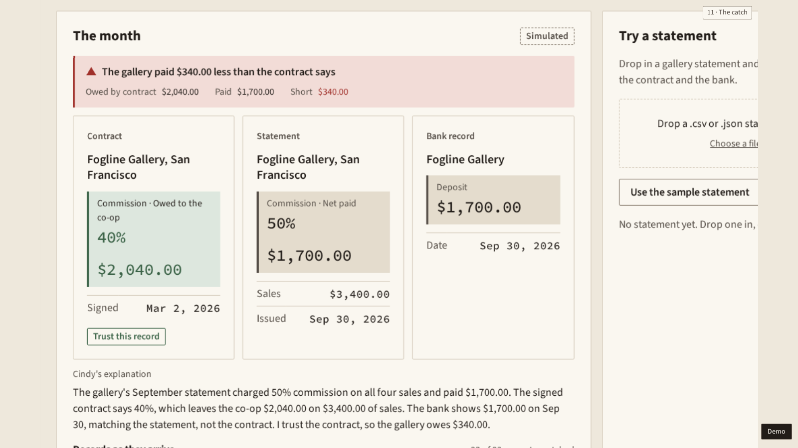

# Cindia · Devpost skeleton

A skeleton for Gordon to finish in his own voice. The scribe refreshed every fact at the freeze, Sunday, Oct 25, 2026, 5:00 AM PT, from [`docs/harness/status.md`](../harness/status.md) (task T6 of the D-sponsors plan).

**How to read it**
- Each section holds facts as bullets, with the source in brackets. Copy what you want and put it in your words.
- A marker that starts with GORDON in square brackets means the words have to be yours. It comes with a question or two to start you.
- Each fact carries a status: **green** (passed its gate), **built and live-tested** (written, live calls passed, no gate on the tour), or **not built**. Don't write a not-built thing as done. [`whats-real.md`](whats-real.md) has the full list.
- Cindia is a platform. Keep calling it one.
- Devpost closes at 9:00 AM PT on Sunday. Be at your assigned table by 10:30 AM for judging ([`docs/reference/ch13-hacker-guide.md`](../reference/ch13-hacker-guide.md)).

## Project name and tagline

- Name: Cindia. It stands for Craft Inheritance Network, Direct from Independent Artisans. Cindy is the agent inside it. [`docs/spec/cindia-pitch.md`](../spec/cindia-pitch.md)
- The tagline: **Describe the vibe. Gift the piece. Pay the person.** It is line 1 of the Cindia pitch card and the end card repeats it. [`src/app/demo/pitch.ts`](../../src/app/demo/pitch.ts) (`TAGLINE`), Gordon's message of Oct 25, 3:25 AM
- The shared one-liner: Cindia is a platform for underrepresented makers, starting with Native American makers. It does the selling, the marketing and the books for them. [`docs/v2/brief.md`](../v2/brief.md), "In one line"

## Inspiration

[GORDON: Inspiration, in your own words. Your earlier draft is in docs/spec/cindia-pitch.md, written before the scope moved to Native American makers, so use it for your voice and not for the facts. Why underrepresented makers, and why Native American makers first? The Anthropic mentors asked "if we don't help them, who will?" What did you see or hear that made you build for this?]

## What it does

**What Cindia is** (the shared line, [`docs/v2/fix-plan.md`](../v2/fix-plan.md) section 1.1)
- Cindia is a platform for underrepresented makers, starting with Native American makers.
- Selling online takes time, broadband and marketing reach that many makers on tribal lands don't have. Cindia does the selling, the marketing and the books for them.
- It's fair by design: the price split is shown, search ranks by fit and not by ads, and Surprise me leans toward makers who sold less.
- The demo follows the Diné Weaving and Silver Co-op, a fictional co-op of Diné (Navajo) makers on the Navajo Nation in Arizona. Its manager is Ruth B. and its makers are Grace N., Lena T. and Mae K. It makes wool weavings and silver and turquoise jewelry. Three more fictional communities sit beside it in the catalog: an Ojibwe beadwork co-op in Minnesota, an Acoma pottery studio in New Mexico and a Seminole patchwork co-op in Florida. The catalog holds 54 fictional pieces. [`docs/v2/brief.md`](../v2/brief.md)
- Every community, maker and story is fictional. Say so wherever they appear.

**Why it matters, with sources** (all from the brief, which links each one)
- Fixed broadband at the FCC's 100/20 Mbps benchmark hadn't been deployed to more than 23% of people living on Tribal lands, the FCC reported in March 2024. [FCC](https://docs.fcc.gov/public/attachments/DOC-401205A1.pdf)
- In 2023, 12.2% of American Indian or Alaska Native households had no bank account, against 4.2% of all US households. [FDIC 2023 survey](https://fdic.gov/household-survey/2023-fdic-national-survey-unbanked-and-underbanked-households-executive-summary)
- On Aug 5, 2026, the U.S. Attorney's Office for the District of Arizona announced that a San Francisco seller had admitted selling over $92,000 of counterfeit Native American jewelry through an eBay store. The jewelry was imported from Asia, and the case was brought under the Indian Arts and Crafts Act. [Indian Arts and Crafts Board](https://www.doi.gov/iacb/san-francisco-woman-convicted-selling-counterfeit-native-american-jewelry)
- An old figure, cited as old: in 2000 the chair of the Senate Committee on Indian Affairs estimated that about half of a roughly $1 billion market for Indian-made goods was counterfeit. [ICT, May 31, 2000](https://ictnews.org/archive/counterfeit-market-reaches-half-billion-dollars/)

**The buyer side** (shop). All of it is green and plays in the tour.
- Vibe search (`d01-vibe`): a buyer types a feeling, such as "a warm, bold gift for my mom. she loves red wool. under $200". Cindy turns it into keywords the buyer can see and edit as chips, our own embedding model finds pieces that match the feeling, and every result says why it matched. The search box's chips come from a rule-based extractor in both modes, because B12's live Finder task (T7) wasn't built. Search runs live on Elastic through B12 (G5 7 of 7, `demo-ok-b12`). [brief, "Shop"], [`status.md`](../harness/status.md)
- Surprise me (`d02-surprise`, chapter 2): one button, three ways (keyword, pure random, fair random), and the screen says which one it used. Fair random leans toward makers with fewer sales this month, and the weights are on the page.
- The piece page (`d03-piece`): the maker's story, hours of work, process steps and a verification line that says it is demo verification. "Where your money goes" shows the price split. Of Grace N.'s $180 weaving, $134.48 goes to her, after $22.00 for materials, an $18.00 Cindia fee and a $5.52 card fee. The same piece through the gallery would pay her $86.00. [`docs/common/data-model.md`](../common/data-model.md) figures 1 and 16, [`docs/common/demo-script.md`](../common/demo-script.md)
- Checkout (`d05-pay`): the card number becomes a token, so the number itself is never stored. The screen says "Demo checkout, no real charge". A project contribution at checkout starts off, and the buyer turns it on. [brief], [`demo-script.md`](../common/demo-script.md)
- The receipt (`d05-pay`, `d12-receipt`): it says "Received" after the sale, promises to show when Grace N. is paid, and turns to "Paid to the maker" when the payout goes out. Grace N.'s own note appears on the paid receipt. [`demo-script.md`](../common/demo-script.md)
- Help, any time (`d04-support`): a drawer answered by the agent swarm. It shows which agent is answering and the guard that checked the answer. When the records can't answer a question about meaning, Cindy says she will ask Grace N., and in `d17-ask-maker` her answer comes back in her own words. In the tour that run is scripted. Live, the swarm forwards the question, and the maker's reply coming back live isn't built. [B14 plan](../plans/B14-swarm.md)
- Communities, projects and works in progress (commissions paid in stages), and a storefront at its own link for each community. The storefront builder is a labeled preview (`d16-store`).

**The seller side** (sell)
- Built in v1 and kept: the money map, the month's reconcile, the catch, approvals with the seal, the close into an Excel file with the impact numbers, Grace N.'s statement, the proof panel, the dashboard, Ask Cindy and the audit trail. [`whats-real.md`](whats-real.md)
- The catch (`d08-catch`): Cindy flags that the gallery paid $340 less than the consignment contract says, lays the contract, the statement and the bank record side by side, says which record to trust, and drafts a follow-up. Nothing goes out until the manager approves it with the seal. [`docs/common/data-model.md`](../common/data-model.md) figures 4 and 9
- Maker pay (`d11-maker`): $95 of Grace N.'s pay is held until the gallery pays what it owes. The statement shows the held line. [`docs/v2/fix-plan.md`](../v2/fix-plan.md) section 1.2
- Listings (`d15-listing`): a maker writes a few lines of notes and the agents draft the listing, suggest keywords, check it against the community's rules and the maker's facts, and embed it into the index. In the tour's scripted run, one of the Checker's three checks fails on purpose, and its note says it is a planted test. The manager approves before anything goes live. [`docs/plans/S3-catalog.md`](../plans/S3-catalog.md)
- The storefront builder (preview), projects and works in progress, and support for sellers are green.
- The counterfeit watch (`d14-watch`): it crawls our own sandbox market (static fictional listings, never the real web) and lists every result it checked. A possible copy sits next to the co-op's piece with its text match, which is 0.74 for the look-alike `cft_01`. A bare claim like "Authentic Native American made" is listed as something the watch can't judge, with no report button. The manager decides whether to report, and Cindy never accuses anyone. **Status: the watch view is green and plays scripted. B15's Claude steps (the claims check on Haiku and the Reporter on Sonnet) are live, but the live Apify crawl got a 403 and B15's G5 failed at the freeze, so don't say the watch crawls live.** [`status.md`](../harness/status.md) B15 row

**The swarm** ([`docs/v2/contracts.md`](../v2/contracts.md) section 6)
- 21 roles, each with one narrow job. Fifteen run on Claude, on `claude-haiku-5-5` and `claude-sonnet-5-5` only. Six are plain code, labeled "rule-based".
- Cindy routes and merges and has no facts of her own. Code fills every number, date and quote.
- A person approves anything that moves money or publishes anything. A safety test sweeps every swarm run and finds no approval, payout or money move (`test_the_safety_sweep_finds_no_forbidden_event_in_any_run` in [`tests/server/test_b14_swarm.py`](../../tests/server/test_b14_swarm.py)).
- Status: the swarm is green (B14, G5 7 of 7 on the tour, `demo-ok-b14`). Live timings: the d04 answer has a median of 5.87 s with the "records say" line quoted, a listing draft takes 6.6 s and a storefront draft 3.3 s.

**The process blocks**
- A bar of 11 clickable blocks across the top of every page. Each shows a live status, a small count and a Live mark when its sources are live. One line sums it up ("Live: N of 11"). Each view draws what is happening and lists the raw events under it. Status: green (F-process, `v2-process`).

**The tour** (green, `I2-tour`)
- Three minutes: a one-minute pitch (three cards: "Cindia", which opens with the tagline, then "Why" and "How it works", text in [`src/app/demo/pitch.ts`](../../src/app/demo/pitch.ts)), the buyer minute, and the seller minute. Chapter 2 adds Surprise me, the proofs, the counterfeit watch, the storefront and a question only the maker can answer. The whole tour is 20 beats and 220 seconds. It is always scripted, so it never waits on a network.
- It plays online at https://cindia.design/demo.
- Presenter mode (`/demo?mode=present`) pauses at the end of every beat. Space or the right arrow plays the next beat, and the left arrow replays the current one.
- It passed G4v2 5 of 5: 220.0 s three times and an offline run, again on design drop 3. [`status.md`](../harness/status.md)

**The edge over Etsy** (two lines, [`docs/v2/fix-plan.md`](../v2/fix-plan.md) section 1.3)
- Etsy pays the shop. Cindia pays the makers, and proves it.
- It does the work for them, pays each maker and not one shop account, runs the books across channels, takes provenance from the community and not the seller, is fair by design with the math shown, and gives each seller a storefront that is theirs. We don't claim lower fees. Cindia's own fee is 10%.
- Sources: [TechCrunch, July 9, 2024](https://techcrunch.com/2024/07/09/etsy-new-seller-policy-2024-generative-ai) and the [Indian Arts and Crafts Board](https://www.doi.gov/iacb/san-francisco-woman-convicted-selling-counterfeit-native-american-jewelry).

**The seats line** (word for word from the tour's end card, `SEATS_LINE` in [`src/app/demo/EndCard.tsx`](../../src/app/demo/EndCard.tsx))

> Cindy's agents fill three seats: bookkeeper, collections and support. A person approves anything that moves money.

## How we built it

**The three pillars** ([`docs/v2/fix-plan.md`](../v2/fix-plan.md) section 1.4)
1. A swarm of small Claude agents, [`docs/plans/B14-swarm.md`](../plans/B14-swarm.md). Green. The server self-test fails on any model ID other than Haiku and Sonnet.
2. Our own embedding model that embeds every seller entry, [`B11-embed`](../plans/B11-embed.md) and [`B12-search`](../plans/B12-search.md). The Indexer embeds each new listing the moment it is drafted, into a drafts index, and moves it to the live index when the manager approves. B11 is built, trained and published (no G5 before the freeze). B12 is green.
3. One database that holds everything, [`B13-live`](../plans/B13-live.md). SpacetimeDB is the system of record and Elastic is the search index built from it. Green.

**The stack** (versions from [`package.json`](../../package.json) and [`server/requirements.txt`](../../server/requirements.txt))
- Browser: React 19.3, TypeScript 6, Vite 8.3, Tailwind CSS 4.3, React Router 8.5, Motion 14.6, Recharts 3.10, SheetJS 0.20.3.
- Server: Python, FastAPI 0.159, the Anthropic Python SDK 2.1, openpyxl 3.1, httpx 0.28.
- Search model: sentence-transformers 6.2, torch 2.14 (CPU build), transformers 5.20, Hugging Face Hub 2.3.
- Tests: Vitest 5, Playwright 1.61, pytest 9.1.

**Our own embedding model and how it was tested** ([`docs/plans/B11-embed.md`](../plans/B11-embed.md), numbers from [`server/b11_embed/report.json`](../../server/b11_embed/report.json)). Built, trained, scored and published.
- Base model: `intfloat/multilingual-e5-small`, 384 dimensions. We fine-tuned it on Cindia's fictional catalog.
- Training data: Claude (Haiku, with one Sonnet retry) wrote 1,045 buyer-style query lines about the 54 fictional pieces, 831 in English and 214 in Chinese, in nine voices. 650 are query-piece pairs and 276 are triplets with a hard negative. The content filter dropped 0 queries. Every pair is kept in `pairs.jsonl` so anyone can audit it.
- Training run: 3 epochs at batch 16, 177 steps, on CPU in 45.8 minutes. The batch is 16 and not 32 because the memory probe measured a peak of 5.18 GB at batch 32.
- Test: held-out test queries, written separately by our data agent. There are 50 of them (40 English and 10 Chinese), over the same 54 fictional pieces, and none was used for training. A guard dropped 40 generated training queries that matched a test query. Nobody on the team wrote or edited any of the 50, so `report.json` has no separate row for that.
- Scoring: Recall at 5 and MRR at 10 for keyword search, the untuned base model, our model and a local hybrid, with paired-bootstrap intervals. The model card says it is a small test, not a benchmark, and names what the model is not for: classifying, ranking or verifying real makers or their work.
- **The numbers:** recall at 5 is **0.789** for our model, **0.784** for keyword search, **0.722** for the base model and **0.825** for the local hybrid. MRR at 10 is 0.892, 0.875, 0.781 and 0.940. Say plainly that our model ties keyword search within noise (recall at 5 +0.005, interval -0.088 to +0.101), beats the base model on MRR at 10 (+0.111, interval +0.022 to +0.206), and is beaten by the hybrid on MRR at 10 (+0.048, interval +0.002 to +0.105).
- The live Elastic hybrid on the same 50 queries: recall at 5 of 0.819 and MRR at 10 of 0.887 (`server/b12_search/eval.json`).
- It is published to a private Hugging Face repo, which carries the model between machines.

**Elastic** ([`docs/plans/B12-search.md`](../plans/B12-search.md)). Green, G5 7 of 7 on the tour.
- One document per piece in `cindia-pieces`, with our own 384-number vector in a `dense_vector` field (cosine, int8 HNSW).
- Hybrid search fuses a kNN retriever on our vectors with a keyword retriever, with price and community filters. The screen says which engine answered. Measured live: the seed takes about 30 s and the tour's query 0.61 s.
- The Agent Builder agent `cindia-finder` answers find questions. The swarm routes those questions to it in code, and the swarm view labels the step "Elastic Agent Builder". It answered in 7.1 s in B12's live run. In B14's G5 the Finder's Agent Builder step timed out at 9.4 s, and the answer came from B12 search at about 17 s. The last committed live eval file reads `agentBuilder: false`, so check `GET /api/b12/status` before you claim the agent in the demo.
- Without Elastic, the same fusion runs locally and the screen says so.

**SpacetimeDB** ([`docs/plans/B13-live.md`](../plans/B13-live.md)). Green, G5 7 of 7 on the tour.
- A local server on `127.0.0.1:3000`. The module has ten private tables. The data view shows eight of them: the catalog (seeded from the mock data with 54 pieces, plus 30 orders and 5 approvals), listings, orders, approvals, swarm runs, steps, process status and the screens watching. Only the publisher's identity can write.
- The browser polls `GET /api/b13/changes` every 500 ms. The process bar shows how many screens are watching. The data view shows each table's row count and newest rows.
- The approval queue moving onto SpacetimeDB (B13's T8) wasn't built. B08 keeps approvals in the server's memory.

**Apify** ([`docs/plans/B15-watch.md`](../plans/B15-watch.md)). Built, partly live, not gated.
- The Scout runs Apify's Cheerio Scraper over our sandbox market, which ships with the public site at `/market/`. The Comparer scores each result with our embeddings, with a threshold of 0.22 measured on the trained model. The Claims agent (Haiku) reads what a listing claims, and the Reporter (Sonnet) fills a report template. The watch never searches the real web.
- **At the freeze Apify answered status 403 to the live crawl in both the worktree and the main tree.** `status.md` calls it an Apify account or token-permission problem and not code. The Claims and Reporter calls are live (the Reporter took 3.3 s). The watch plays scripted, and B15's G5 failed.

**Nessie** ([`docs/plans/B04-bank.md`](../plans/B04-bank.md), [`B16-bank-books`](../plans/B16-bank-books.md)). B04 and B16 are built and live-tested against the sandbox. Neither passed a G5 on the tour.
- The sale posts to a Nessie account as a deposit of $156.48 (the $180 after the Cindia fee and the card fee). Maker payouts post as withdrawals, and the money map's balance is read back from the account.
- Nessie can't create purchases or transfers, so we use deposits and withdrawals.
- B16 reads the bank side back from Nessie, so the $340 catch is found against Nessie's own records, and the community fund contribution posts as a deposit. Measured live: seed 8.3 s, reconcile 1.2 s, fund move 1.9 s. Its live specs pass, 6 of 6 with B16 live. Nessie is a sandbox bank, so no real money moves.
- B04's G5 went 12 of 13 and then 11 of 13. The misses were v1 harness timing, and B04's own live calls held.

**The Claude models, per agent** ([`docs/v2/contracts.md`](../v2/contracts.md) section 6)
- `claude-haiku-5-5` (6 agents): Cindy, Intake, Finder, Clerk, Tagger and Claims.
- `claude-sonnet-5-5` (9 agents): Curator, Steward, Writer, Lister, Describer, Checker, Explainer, Reporter and Designer.
- Plain code (6 agents): Indexer, Matcher, Bookkeeper, Scorer, Scout and Comparer.
- No Opus anywhere in the platform. B02 and B07 call Sonnet and B09 calls Haiku (`server/routers/`).

**The build harness**
- A team of Claude Code agents wrote the code. The roles are orchestrator, scaffolder, data-smith, feature-lead, builder, verifier, integrator, backend-builder, scribe and a design lead. Each agent can write only to its own paths, and hooks block anything else. [`CLAUDE.md`](../../CLAUDE.md)
- Gates stop the build until recorded checks pass, and a verifier reviews screenshots and never fixes anything. The hook self-test passed 338 of 338 when the cloud session started. [`docs/common/definition-of-done.md`](../common/definition-of-done.md)
- The build used Opus for builders and leads and Sonnet for the verifier and scribe. This is the build, not the platform. [`docs/harness/decisions.md`](../harness/decisions.md)
- The design work ran through the Figma MCP server, with a stage log of five entries. Design drop 3 is applied and passed G4v2. [`design/stage-log.md`](../../design/stage-log.md)

[GORDON: How we built it, in your words. What was it like to run a team of agents through the night? What did you decide yourself, and what did you hand to the agents?]

## Challenges

Facts from [`docs/harness/lessons.md`](../harness/lessons.md) and [`status.md`](../harness/status.md). Pick the ones that fit your story.
- **The bank can't do purchases.** Nessie has no way to create purchases or transfers, and its create calls answer with a plain string. We use deposits and withdrawals and read the list back to find the new record. Its account balance may not follow deposits, so we compute the balance from the lists.
- **A slow first call.** In one live run, Nessie's first sale took 1,755 ms, against about 800 ms after that, and the demo's receipt status missed its window.
- **Apify said no.** The live crawl for the counterfeit watch got a 403 from Apify in both trees at the freeze, so the watch plays scripted and B15 didn't pass its gate.
- **The Agent Builder is slow and limited.** The Elastic trial limits LLM tokens, and the swarm's Agent Builder step timed out at 9.4 s in B14's G5, so the find answer came from B12 search at about 17 s.
- **The Claude API changed on Oct 21, 2026.** No `temperature`, `top_p` or `top_k`, no enabled thinking and no prefilled assistant turns.
- **Time budgets.** B02's live call took 7.9 s on Sonnet against a 6 s budget, and B09's live call went over 4 s in one of four runs. We raised B09's timeout to 5 s, a contract change.
- **A crowded VM.** Several agents running test suites at once pushed the load average to 13.8 on 4 vCPUs, and the demo's timing checks flaked. B12's first G5 failed only its live tour, at a load of 7.7. Gates now run one at a time at raised priority.
- **A screenshot can't prove a live source played**, because the scripted fallback draws the same pixels. The live runs now assert the store's `sources` for the upgrade's key.
- **Training on a CPU.** The model's memory probe peaked at 5.18 GB and 14.7 s a step at batch 32, so we trained at batch 16, which took 45.8 minutes.
- **Keeping the test queries out of training.** The eval-leak guard dropped 40 generated queries that matched a test query.
- **Re-skinning with every number kept.** Long English titles wrapped and pushed the held $95.00 line out of a fixed frame, so the first R0 gate run failed. We shortened list rows to one line and kept every figure.
- **English only, late.** At 11:35 PM Gordon decided the site renders English only. The Chinese text is still in the code and the mock data, and nothing renders it.
- **Windows and the cloud.** `os.replace` fails on Windows while another process has the file open, which gave a flaky save in the Excel builder. A unique file per build fixed it.
- **Agents reporting results they hadn't read.** Leads sometimes reported a verifier's or builder's result before it arrived. The rule now is to state only a result you have read.

[GORDON: Challenges, in your words. What nearly broke the demo? What did you decide about telling stories of communities you haven't worked with yet, and what did you do about it?]

## Accomplishments

Checked facts at the freeze.
- **v1 is green as `demo-ok-4`,** the fallback. All 12 features passed their gates (3 of 3, verifier PASS), and the G4 demo gate passed 5 of 5 on 60-second runs. [`status.md`](../harness/status.md)
- **v2 is green end to end.** Every v2 feature and migration passed its gate, and the 3-minute tour passed G4v2 5 of 5 (220.0 s three times and an offline run), then again on the final look (`demo-ok-v2-d3`). [`whats-real.md`](whats-real.md)
- **Three backend upgrades passed G5 with a live tour run, 7 of 7 each:** B12 vibe search on Elastic, B13 SpacetimeDB and B14 the agent swarm on Claude. v1's B01, B03, B05, B06, B08, B09 and B10 passed G5 on v1's timeline.
- **Our own model is trained and published.** Recall at 5 is 0.789 against 0.784 for keyword search and 0.722 for the untuned base model, and the local hybrid reaches 0.825, on 50 held-out test queries written separately by our data agent. A small test, not a benchmark.
- **The planted-error score is 4 of 4.** The matcher catches every error planted in the month's records. [`data-model.md`](../common/data-model.md) figure 10
- **The public site is live** at https://cindia.design and plays the whole tour.
- **The re-skin kept every number.** The R0 gate passed 11 of 11 checks with three verifiers, and the $180 weaving, the $134.48 maker share, the $340 short payment and the $95 held are unchanged. [`status.md`](../harness/status.md)
- **The server suite ran 874 tests** in B13's G5. [`status.md`](../harness/status.md)
- **Every simulated panel says so.** The Simulated badge stays on anything still playing scripted events, and [`whats-real.md`](whats-real.md) lists what is live and what isn't.

[GORDON: Accomplishments, in your words. Which one are you proudest of? What would you show a friend first?]

## What we learned

[GORDON: What we learned, in your words. What surprised you about building for communities you haven't worked with yet, about running a swarm of small agents, or about building alone? What would you do differently on Monday?]

## What's next

- **Co-design comes first.** Work with Native-led arts organizations, and use the marks and processes communities already run instead of issuing a mark of our own. In a real launch, makers would be enrolled members of their nation or certified by it as Indian artisans, as the Indian Arts and Crafts Act defines. Cindia would keep only a yes or no, never the record, and each community would control what is indexed about it. [`docs/v2/brief.md`](../v2/brief.md), "Next: other communities"
- **The "Backend if time" items that weren't built.** All nine are unbuilt at the freeze (the ask-the-maker loop is partly there). [`whats-real.md`](whats-real.md)
  - Live keywords from the Finder in the search box (B12's T7).
  - Gordon's own 15 test queries, scored as their own row.
  - Photos on the listing form and the Describer's layer.
  - The approval queue moved onto SpacetimeDB (B13's T8).
  - A hosted live API, so judges can try it online.
  - A real storefront builder.
  - The live loop back from the maker for "ask the maker". The swarm already forwards the question live.
  - A longer training run on the lab GPU machine.
  - An Apify actor that others can use (B15's T7).
- **Finish what the freeze left.** Get B15's live crawl past Apify's 403, then run G5 for B15, B11 and B16. Then drop 3's feature layout rounds: the search result cards, the piece page and receipt layout, the support drawer's step strip, seller-hub's three columns, the money map lattice, the catch line, the store hero, maker-statement, communities, the presenter hint and the drawer scrim. [`status.md`](../harness/status.md), Cut and simulated
- **The storefront builder beyond the preview.** Each seller would build their own storefront.
- **Other underrepresented makers,** each community only with that community's own organizations. The brief cites 476.6 million Indigenous people in the world, 6.2% of the global population and 18.2% of the people living in extreme poverty. [World Bank](https://www.worldbank.org/ext/en/topic/social-development/indigenous-peoples)

## Every community, maker and story here is fictional

> Every community, maker and story here is fictional. The crafts are real traditions. We haven't worked with these communities yet, and a real launch starts with them.

## Built with

- React, TypeScript, Vite, Tailwind CSS, React Router, Motion, Recharts, SheetJS
- Python, FastAPI, openpyxl, httpx
- Claude (`claude-haiku-5-5` and `claude-sonnet-5-5`) through the Anthropic Python SDK
- Claude Code, for the build
- sentence-transformers, PyTorch and the Hugging Face Hub
- Elastic Serverless and Elastic Agent Builder
- SpacetimeDB
- Apify (built, but its live crawl was blocked by a 403 at the freeze)
- Capital One's Nessie sandbox API
- Figma, through the Figma MCP server, FigJam and Figma Slides
- Playwright, Vitest and pytest
- Cloudflare Pages and a GoDaddy Registry domain, cindia.design

## Tracks

Select a track on Devpost only when its hard requirement is met. The line after each track says whether it is, from the final what's-real list. [`sponsors/README.md`](../../sponsors/README.md) has the reasons. Gordon checked the Devpost prize names live at 11:45 PM on Oct 24.
- [Anthropic] Claude for Public Benefit: [`sponsors/anthropic/`](../../sponsors/anthropic/README.md). **Met.** One item is yours: who you talked to.
- Hyphenate, The Hyphenated Enterprise: Autonomous Systems for Finance: [`sponsors/hyphenate/`](../../sponsors/hyphenate/README.md). **Met on the build.** The video that opens with the catch is yours to link.
- Visa, Best use of Reimagining Shopping: [`sponsors/visa/`](../../sponsors/visa/README.md). **Met.**
- Microsoft, Built for the Real World: [`sponsors/microsoft/`](../../sponsors/microsoft/README.md). **Met.**
- Capital One, Best Use of Nessie: [`sponsors/capital-one/`](../../sponsors/capital-one/README.md). **Met in use, not gated.** Nessie was used live, and neither B04 nor B16 passed a G5.
- Meta, Bringing People Closer Together with AI: [`sponsors/meta/`](../../sponsors/meta/README.md). **Met on the tour.** The maker's answer is scripted.
- Elastic, Best use of the Elastic Agent Builder on a Serverless instance: [`sponsors/elastic/`](../../sponsors/elastic/README.md). **Met if `GET /api/b12/status` reads `agentBuilder: true`.** Check it first and take the Kibana screenshot.
- [Spacetime] Best Use of Spacetime: [`sponsors/spacetimedb/`](../../sponsors/spacetimedb/README.md). **Met.**
- Apify, Best use of Apify: [`sponsors/apify/`](../../sponsors/apify/README.md). **Not met at the freeze.** The live Apify call got a 403. Your decision.
- [Figma] Best Figma Workflow Hack ($1,000): [`sponsors/figma/`](../../sponsors/figma/README.md). **Not yet.** The workflow video is the missing hand-in.
- [MLH] Best Domain Name from GoDaddy Registry: [`sponsors/mlh-godaddy/`](../../sponsors/mlh-godaddy/README.md). **Met.** The domain is cindia.design, and .design is a GoDaddy Registry domain.
- Cal Hacks Best Solo Hack: select it. Gordon built Cindia alone. (The Devpost notes in [`docs/reference/ch13-devpost.md`](../reference/ch13-devpost.md) call it automatic, and Gordon's Oct 25 message says to select it.)
- Cal Hacks Best People-First Social Impact Hack: select it. Cindia is built for Native American makers, and the demo follows the fictional Diné Weaving and Silver Co-op.

## Links

- Repo: https://github.com/tyang4-ai/calhacks2026
- Public site: https://cindia.design (also https://cindia-cfn.pages.dev). The tour runs at https://cindia.design/demo. It is the scripted public build, with no Pay and no Live switch, and it sells nothing. Gordon uploaded it from commit `b01fc1b` to the Cloudflare Pages project `cindia`, and a new upload from the final build follows the freeze. [`docs/plans/D-deploy.md`](../plans/D-deploy.md)
- Demo video: [GORDON: video link]. Hyphenate wants a video that opens with the catch (`d08-catch`, a $340 short payment), and `/demo?video=1` plays it that way. Figma's limit is 3 minutes.
- Project image, the tour's catch beat (`d08-catch`: the gallery paid $340.00 less than the contract says):

The file is [`docs/devpost/project-image.png`](project-image.png).

## Devpost checklist

From [`docs/reference/ch13-devpost.md`](../reference/ch13-devpost.md) and [`ch13-hacker-guide.md`](../reference/ch13-hacker-guide.md):
- [ ] An image of the project (`project-image.png`) and the GitHub repository link
- [ ] A recorded demo video (the judging criteria ask for a clear one for sponsors reading later)
- [ ] The track selections above
- [ ] Submit by 9:00 AM PT on Sunday, and be at your assigned table by 10:30 AM for judging
