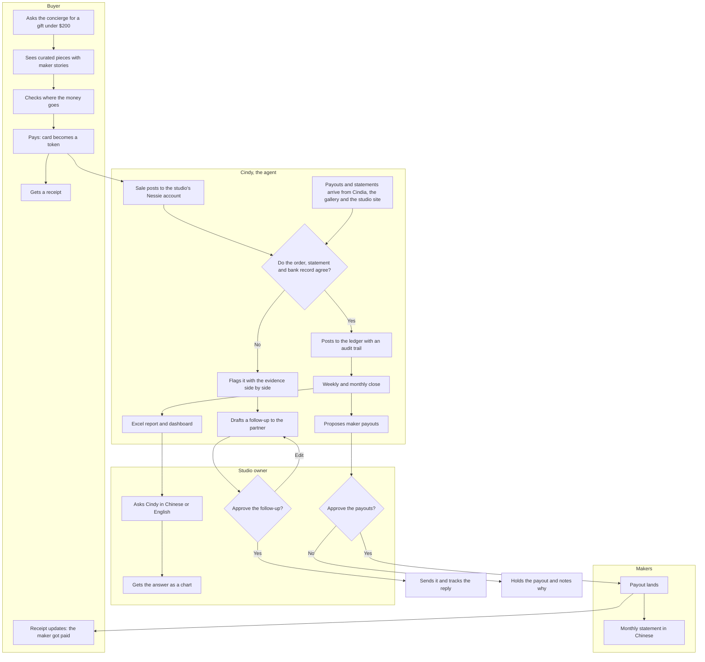

# Cindia · spec v0.2

**Cindia: Craft Inheritance Network, Direct from Independent Artisans.** A marketplace where buyers get heritage crafts straight from the people who make them, and an AI agent (Cindy) runs the makers' money.

- **Built for the makers, shown through a buyer.** The makers are the customer and the community. The demo starts with a buyer because every judge has shopped, then follows the buyer's money into the studio.
- **The demo and the idea matter more than the product.** Everything starts as a frontend with hardcoded mock data. Backend pieces then replace hardcoded parts one at a time, in the order in section 5, as time allows.

Planning only. Cal Hacks rules say all implementation happens at the event, so no code or mock data files before Saturday. Pitch and Devpost draft: [[cindia-pitch]]. Event hub: [[cal-hacks-13]].

## 1. The story in one breath

Three problems are killing heritage crafts:
- **Time:** makers spend their days selling instead of making.
- **Legacy:** young people won't inherit a craft that doesn't pay.
- **Trust:** buyers can't tell real from fake, and middlemen take the margin.

Cindia sells straight from the maker and takes the money side off their hands.

**Demo case:** a Gu embroidery (顾绣) studio with three makers that sells through Cindia, a gallery in San Francisco, and its own site.

## 2. Who uses it

| Role | Who | What they need |
|---|---|---|
| Makers | The three artisans, the people Cindia is for | To get paid on time and see what each piece earned |
| Studio owner | Runs the Gu embroidery studio, works in Chinese | To stitch, not do books. Approves anything that moves money |
| Buyer | Someone in the US looking for a meaningful gift. The demo's way in | To know it's real and that the maker gets paid |
| Gallery | SF gallery selling on consignment | Pays monthly, sometimes short |
| Cindy | The agent | Matches, flags, drafts and proposes. Never approves its own work |

## 3. The demo (60 seconds, told from the buyer's side)

| Time | Beat | Features |
|---|---|---|
| 0:00 to 0:15 | **The buyer:** asks for a gift, reads the maker's story, sees the price split, pays, and the card becomes a token | F1, F2, F3, F4 |
| 0:15 to 0:20 | **Follow the money:** the $180 lands in the studio's Nessie account | F6 |
| 0:20 to 0:50 | **The makers:** the month fast-forwards, payouts get matched, the $340 catch, the owner approves on the phone, the month closes into Excel, a maker's statement in Chinese | F7, F8, F9, F11, F12 |
| 0:50 to 1:00 | **Back to the buyer:** the receipt updates to show the maker got paid, and how much | F5 |

- **Keep the buyer part under 15 seconds.** Past that it reads as a shopping app, and four of the five tracks judge what happens after the money lands.
- **Video:** a 5-second cold open on the catch ("the gallery paid $340 less than the contract says"), then rewind to the buyer. Hyphenate wants the video to open with the moment.
- **At the table:** every judge starts with the buyer, except Hyphenate's, who start at the catch.
- **Ask Cindy (F14) and the proof panel (F15)** come after the 60 seconds, during questions.

## 4. Features

- **Priority:** P0 = in the 60-second demo or needed at judging. P1 = should have.
- **Every feature starts hardcoded.** The last column names the backend upgrade (section 5) that makes it real.

| # | Feature | What it does | Wow moment | Sponsors | Pri | Made real by |
|---|---|---|---|---|---|---|
| F1 | Shopping concierge | Buyer types a request ("a gift under $200 for my mom, she loves peonies") and gets three pieces with reasons | The storefront rearranges itself into a curated set | Visa | P0 | B9 |
| F2 | Maker story card | Each piece shows its maker, craft, hours of work, materials and heritage status | A process timeline, from sketch to 120 hours of stitching | Visa, Anthropic | P0 | Content only |
| F3 | Where your money goes | The price splits into maker share, materials, Cindia fee and card fee | The price bar splits apart on hover | Visa, Anthropic, Microsoft | P0 | B10 |
| F4 | Secure checkout (simulated) | Card details become a token and the sale posts to the studio account | The card number morphs into a token | Visa, Capital One | P0 | B4 |
| F5 | Paid receipt | After the payout, the buyer's receipt shows who got paid, how much, and when | The receipt flips to "paid to the maker" | Visa, Anthropic | P0 | B10 |
| F6 | Money map | The studio's account on Nessie, with sales, payouts, materials and maker pay shown as live flows | Money flows from buyers to the studio to the makers | Capital One, Hyphenate | P0 | B4 |
| F7 | Fast-forward a month | Plays a month of orders, statements and bank records while Cindy matches each payout to its orders, including bundled payouts, fees and refunds | A time-lapse where matched lines snap together | Hyphenate, Microsoft, Anthropic | P0 | B1 |
| F8 | The catch | When records disagree (the gallery paid $340 less than the consignment contract says), Cindy puts the contract, statement and bank record side by side and says which to trust and why | A red flag with three evidence panels | Hyphenate, Anthropic, Microsoft | P0 | B1, B2 |
| F9 | Approvals and limits | Cindy drafts the follow-up and proposes maker payouts, and the owner approves on a phone. Cindy can't approve its own proposals, and payouts over a limit always need the owner | The phone buzzes and the owner swipes to approve | Hyphenate, Microsoft, Anthropic | P0 | B2, B8 |
| F10 | Audit trail | Every number traces back to the record, rule or person behind it | Click any number and its trail unfolds back to the bank record | Hyphenate, Microsoft | P1 | B10 |
| F11 | Maker statements in Chinese | Each maker gets a monthly statement in Chinese (with an English toggle): pieces sold, their share, payout date | A maker's phone shows 本月收入 with their pieces | Anthropic, Capital One, Hyphenate | P0 | B10 |
| F12 | Weekly and monthly close | Closes the books and writes a real .xlsx: ledger, reconciliation, profit and loss, per-maker earnings, a chart | The Excel file drops onto the screen and opens with live formulas | Microsoft, Hyphenate | P0 | B6 |
| F13 | Dashboard | A BI-style dashboard that builds tile by tile: revenue by channel, maker share, cash, open flags. Stretch: a Power BI Desktop file reading the same workbook | Tiles assemble as the month closes | Microsoft, Hyphenate | P1 | B10 |
| F14 | Ask Cindy | The owner asks in Chinese or English ("这个月哪件作品最赚钱?") and gets a chart or card back, linked to the audit trail. Also answers "why did you flag this?" | A question in Chinese turns into a chart | Anthropic, Microsoft, Hyphenate | P0 | B7 |
| F15 | Proof panel | A planted-error test set with an answer key, a score, and a real-or-simulated label on every part | The scoreboard fills to "caught 4 of 4" | Hyphenate, Microsoft | P0 | B3 |
| F16 | Impact numbers | Maker share of each sale, hours of bookkeeping saved, days until makers get paid | The numbers count up at month close | Microsoft, Anthropic, Visa | P1 | B10 |
| F17 | Judge's scenario | Drop in a new statement or CSV during judging and Cindy processes it live. Hyphenate says judges may bring a scenario of their own | A judge's file gets reconciled on the spot | Hyphenate, Microsoft | P1 | B5 |
| F18 | Demo controls | Play, reset, fast-forward, offline mode, scripted or live switch | A clean 60-second run every time | All | P0 | Frontend from the start |

## 5. Build plan

### Phase 1: the frontend, all hardcoded

- Every screen in section 4, driven by the mock data in section 6.
- **The front end plays a stream of events:** agent step, money move, approval request, flag, ledger entry. In phase 1 a script fires them on a timer. Each backend upgrade swaps one source of events for a real one, so the screens don't change and nothing gets thrown away.
- Demo controls (F18) and offline mode from the start.
- A pre-made .xlsx for F12 and two or three canned answers for F14.
- Runs offline on the laptop and online on a phone.
- **Done when** the 60-second demo in section 3 runs clean three times in a row, offline. That build is also the networking demo.

### Phase 2: backend upgrades, in priority order

Build top to bottom and stop wherever time runs out. The times are rough guesses.

| Order | Upgrade | Replaces | Helps | Time |
|---|---|---|---|---|
| B1 | A real matcher over the mock records: orders, statements and bank records in, matches and flags out | The scripted matches and flags in F7 and F8 | Hyphenate, Microsoft | 2 h |
| B2 | Claude reads the contract, statement and bank record, explains the catch in Chinese or English, and drafts the follow-up | The scripted text in F8 and F9 | Anthropic, Hyphenate | 1.5 h |
| B3 | The proof panel runs the matcher on the planted errors and scores it against the answer key | The static score in F15 | Hyphenate, Microsoft | 1 h |
| B4 | Nessie: seed the studio's account, post the sale, and read the account back for the money map | The animated fixtures in F4 and F6 | Capital One | 1.5 h |
| B5 | Judge's scenario: upload a statement or CSV and run it through the matcher live | Nothing yet, F17 is new | Hyphenate | 1 h |
| B6 | The Excel file built from the ledger | The pre-made .xlsx in F12 | Microsoft | 1 h |
| B7 | Ask Cindy with Claude tool use, answering with chart specs | The canned answers in F14 | Anthropic, Microsoft | 1.5 h |
| B8 | Approvals across two screens, with the owner on a phone or a second tab | The scripted approval in F9 | Hyphenate | 1 h |
| B9 | The concierge with Claude over the catalog | The scripted results in F1 | Visa | 1 h |
| B10 | Everything else computed from the ledger: price split, paid receipt, audit trail, statements, dashboard, impact numbers | The hardcoded numbers in F3, F5, F10, F11, F13, F16 | Microsoft, Hyphenate | 2 h |

- **Minimums per track:** Anthropic needs B2 for any real use of Claude, and Capital One needs B4 for any real use of Nessie. Hyphenate judges how real it is, so B1, B3 and B5 carry the most weight there. Microsoft judges end-to-end functionality, so B1 and B6.
- **Label what's still hardcoded.** The proof panel and the Devpost page say what's real and what's simulated. Hyphenate asks for this directly.
- **Stop building three hours before the 9:00 AM deadline** to record the video, write Devpost and do a dry run.

## 6. Mock data (described here, written Saturday)

- **Catalog:** six Gu embroidery pieces, each with a maker, hours of work, materials, price and a short story. One is the $180 peony piece the buyer picks. Use photos you have the rights to, or clearly marked placeholders.
- **People:** the studio owner and three makers. Pick names on Saturday, and use a real artisan's name only with their OK.
- **Channels:** Cindia, the SF gallery (consignment, a monthly statement, commission set by contract), and the studio's own site (card processor payouts, bundled and net of fees).
- **One month of records:** about 30 orders across the three channels, every payout and statement, the matching bank records, and the gallery's consignment contract.
- **Planted errors, with an answer key:**
  1. Short: the gallery pays $340 less than the contract says. This is the catch.
  2. Bundled: one card processor payout covers three orders.
  3. Refund: a refund is netted out of a later payout.
  4. Late: a payout lands after the month closes and carries into the next month.
- **Canned answers for Ask Cindy:** two or three, starting with 这个月哪件作品最赚钱?
- **One held-back statement** for the judge's scenario (F17), to show the upload if a judge doesn't bring a file.

## 7. How each sponsor is covered

| Sponsor | What they judge | Features | What to say | Gap to close |
|---|---|---|---|---|
| Anthropic: Claude for Public Benefit | A named community, a real problem you lived or heard firsthand, it works, thoughtful use of Claude | F2, F5, F8, F9, F11, F14 | "Claude reads every contract and statement, explains each match in Chinese or English, and never moves money without the owner's OK" | Talk to one real artisan before Saturday. B2 is the minimum for real Claude use |
| Microsoft: Built for the Real World, Customer Impact Award | A production-minded AI agent for a meaningful problem in finance, productivity, healthcare or another high-impact area. Customer understanding, measurable usefulness, path from prototype to production, responsible design, end-to-end functionality | F7, F9, F10, F12, F13, F15, F16 | "The owner gets the month's books in Excel without building a spreadsheet, and the number I track is hours of bookkeeping saved" | A one-sentence production story: real bank feeds in place of Nessie, with Excel and Power BI already in the loop. B1 and B6 make it end to end |
| Visa: Reimagining Shopping | Innovation 25%, user experience 25%, technical execution 20%, commerce impact 15%, trust and responsibility 15% | F1, F2, F3, F4, F5, F16 | "Before paying, the buyer sees who made the piece, how long it took, and how much of the price reaches the maker" | Checkout is simulated, so say so. Their Saturday fireside chat covers tokenization and real-time risk scoring, which is what F4 shows |
| Capital One: Best Use of Nessie | Completeness, creativity, complexity | F4, F6, F7, F11 | "Every sale, payout and maker payment runs through Nessie, so the books reconcile against a bank, not a spreadsheet" | B4 is the minimum for real Nessie use. Nessie has no documented way to create purchases or transfers (section 9) |
| Hyphenate: Autonomous Systems for Finance | Is it real enough, would you hire it, did we see something new, the moment. Bring a video that opens with the moment, a live demo, one line on the roles, and proof it works | F7, F8, F9, F10, F14, F15, F17 | "It fills two roles: the bookkeeper who matches payouts to orders, and the person who chases a partner who pays short" | B1, B3 and B5, so the catch, the score and a judge's own scenario are real |

Also eligible: Best Solo Hack (automatic for one-person teams) and Best People-First Social Impact Hack.

## 8. User flowchart

## 9. Nessie: what the docs allow (checked Oct 21)

- **API key:** sign in with GitHub at nessieisreal.com, then pass the key as `?key=...` on every request.
- **What you can create:** customers, accounts, deposits, withdrawals, bills, loans and merchants.
- **What you can't create:** purchases and transfers only have get, update and delete by ID in the docs. There's no documented way to create them.
- **Plan:**
  - Sales and incoming payouts go in as deposits.
  - Materials and maker pay go out as withdrawals, with the merchant or maker named in the description.
  - On Saturday morning, try `POST /accounts/{id}/purchases` and `POST /accounts/{id}/transfers` in case they work anyway.
  - Ask at the Capital One booth. The Hacker Guide lists their Sat 12:00 slot as a Nintendo Smash Bros tournament, not a Nessie session.
- **Amounts are integers,** so store cents.
- **Create calls return a plain string** ("Deposit created"), not the new object, per the spec. Read the list back after each create to get the new IDs.
- **Base URL:** the spec lists prod-api.nessieisreal.com and qa-api.nessieisreal.com, but Getting Started shows api.nessieisreal.com. Test which one answers.
- **Full reference:** [[ch13-sponsor-capital-one]]. The raw spec file is [[ch13-nessie-openapi-spec.yaml]].

## 10. Open decisions

- **Where the matcher runs:** in the browser, or on a small backend. Claude calls need a small server either way, to keep the API key out of the page.
- **Backend:** FastAPI or Node
- **Excel:** generated in the browser (SheetJS) or on the backend (openpyxl)
- **Price breakdown:** the fee model (Cindia's cut, card fee)
- **Hosting:** Cloudflare Pages plus an offline copy
- **Anthropic:** which real artisan to quote
- **Visa:** whether F4 shows a real-time risk score at checkout, next to the token (both are topics of Visa's fireside chat)
- **Saturday conflicts** (see [[ch13-schedule]]):
  - Visa's fireside chat and Capital One's slot (a Smash Bros tournament, per the Hacker Guide) are both 12:00 to 1:00
  - Anthropic is 1:00 to 2:00
  - The Hyphenate mixer is 2:00 to 3:30
  - Annapurna Labs is 3:00 to 4:00
